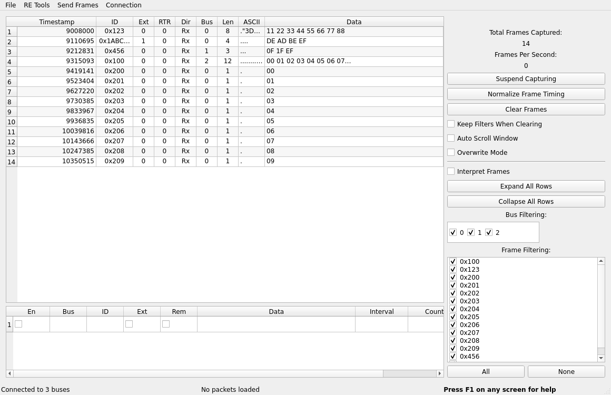

# USB2CAN Triple on Linux (SocketCAN)

SocketCAN driver for the CANLAB **USB2CAN Triple** adapter: three CAN
connectors on one USB port, CAN1 and CAN2 classic CAN, CAN3 CAN FD.
Hardware: https://www.canlab.cz

The adapter enumerates as a CDC ACM serial port (`/dev/ttyACMx`, USB
`04d8:f0d7`). The kernel module `usb2cansocketcan` is a tty line
discipline that turns that port into three CAN network devices. Everything
else is standard SocketCAN: `ip link`, `candump`, `cansend`, python-can,
Wireshark, ...

Driver v2.0 (October 2026) is a rewrite on the kernel's CAN device API.
It is verified on two adapters wired back to back; see `doc/PLAN.md` for
the protocol facts and the test record. Firmware 1.41.

## Requirements

* Linux 5.15 or newer with CAN support (`can`, `can-raw`, `can-dev`,
  `cdc-acm`: built into most distribution kernels).
* Kernel headers for building: `linux-headers-$(uname -r)` (Debian/Ubuntu),
  `kernel-devel` (Fedora).
* `ldattach` (util-linux) and `can-utils`.

Verified builds: Ubuntu 22.04 (5.15), Ubuntu 24.04 (6.8), Fedora 44 (7.2),
WSL2 (6.6). The container matrix is in `ci/kbuild/`.

## Build and load

```sh
git clone https://github.com/canlab-cz/triple
cd triple/driver
make
sudo insmod usb2cansocketcan.ko
```

To install permanently with DKMS:

```sh
sudo cp -r driver /usr/src/usb2cansocketcan-2.0
sudo dkms add -m usb2cansocketcan -v 2.0
sudo dkms build -m usb2cansocketcan -v 2.0
sudo dkms install -m usb2cansocketcan -v 2.0
```

## Use

Attach the line discipline (29) to the adapter's serial port, then
configure the three interfaces like any other SocketCAN device:

```sh
sudo ldattach 29 /dev/ttyACM0
ip -br link show type can          # can0 can1 can2 appear
sudo ip link set can0 type can bitrate 250000
sudo ip link set can1 type can bitrate 500000
sudo ip link set can2 type can bitrate 125000 dbitrate 6700000 fd on
sudo ip link set can0 up
sudo ip link set can1 up
sudo ip link set can2 up
candump -H any                     # -H shows the adapter's hardware timestamps
```

`scripts/triple-attach.sh ttyACM0` does all of the above with these
defaults; `scripts/triple-detach.sh` undoes it. To detach a single adapter,
kill its `ldattach` process; unplugging the adapter works too.

Supported settings:

| Port | `bitrate` | `dbitrate` (`fd on`) | Other |
|---|---|---|---|
| CAN1, CAN2 | 10k 20k 33333 50k 62500 83333 100k 125k 250k 500k 1M | - | `listen-only on` |
| CAN3 | 125k 250k 500k 1M | 250k 500k 833333 1M 1.5M 2M 3M 4M 5M 6.7M 8M 10M, higher than `bitrate` | `listen-only on`, `fd on`, `fd-non-iso on` |

CAN3 always runs as CAN FD in the firmware. Without `fd on` the interface
only sends and receives classic frames and the data bitrate defaults to the
next value above the nominal one.

`ip -details -s link show can0` shows the bus state and the error counters
reported by the adapter; error frames are delivered to sockets on state
changes (`candump -e any,0:0,#FFFFFFFF`).

Per-adapter interface names: the three devices carry `dev_port` 0, 1, 2
(CAN1..CAN3) in sysfs, and the USB serial number is reachable through the
parent device, so a udev rule can name them. `etc/udev/rules.d/` has an
example together with a rule that starts `ldattach` automatically when an
adapter is plugged in (`etc/systemd/system/usb2can-triple@.service`).

## Limits

* Frames longer than 100 bytes on the wire (CAN FD with many data bytes
  equal to 0x0F, 0x1F or 0xEF, which need escaping) are dropped with
  `tx_dropped`, because they lock up the adapter firmware until it is power
  cycled. Module parameter `max_wire_len` raises the limit if a newer
  firmware allows it.
* Sustained receive rate is limited by the adapter's USB side: roughly
  2000 to 5000 frames/s per adapter (measured through usbipd into WSL2),
  and the firmware drops silently beyond that. Transmit is only limited by
  the bus. `hwtstamp=0` turns the adapter's receive timestamps off.
* User defined bit timing (the old `-c` option) is not available yet; the
  firmware's fixed bitrate table is used.
* The trigger/marker input and the firmware's bus-off indication are not
  decoded yet (bus-off has not been observed on hardware).

`debug=1` (module parameter or `/sys/module/usb2cansocketcan/parameters/debug`)
hex dumps every message exchanged with the adapter.

## GUI analyzer: SavvyCAN

`gui/savvycan/` adds a native "CANLAB USB2CAN Triple (serial)" connection
type to [SavvyCAN](https://github.com/collin80/SavvyCAN): three buses per
adapter, bitrates and FD settings from its connection window, hardware
timestamps, transmit on all buses. It talks to the adapter over the serial
port, so it works without the kernel module and on Windows too. See
`gui/savvycan/README.md` for build and use.



`tools/canopen_sim.py` is a small simulated CANopen node (heartbeat, NMT,
SDO, EMCY, PDOs; EDS in `tools/canopen_sim.eds`) for testing CANopen tools
on any SocketCAN interface.

## Without the kernel module

`tools/triple_dump.py` talks to an adapter directly over its serial port
with pyserial and prints received frames; it runs on Windows and macOS as
well (`python3 tools/triple_dump.py COM7 --send 1 123#11223344`). It cannot
share a port with the kernel driver. The wire protocol is documented in
`doc/protocol.md`; `tools/triple_proto.py` is the Python codec it uses.

## Development

* `make -C tests/codec test` runs the host-side codec test, including byte
  sequences captured from the firmware; `python3 tools/test_triple_proto.py`
  runs the same vectors against the Python codec.
* `sh ci/kbuild/run.sh` compiles the module against several kernel header
  sets in Docker.
* `doc/PLAN.md` is the roadmap: next is a CAN bus analyzer GUI.

Driver v1.x (tty line discipline plus the `tripled` daemon, kernels up to
5.15) lives in the git history before tag `v2.0`.

## License

Each source file states its license in an `SPDX-License-Identifier` line;
the full texts are in `LICENSES/` and `LICENSE` lists the assignment.

| Part | License |
|---|---|
| Kernel module `driver/triple.c` | GPL-2.0 (required for a Linux kernel module) |
| Protocol codec `driver/triple_proto.[ch]`, SavvyCAN connection `gui/savvycan/`, Python tools `tools/`, tests | MIT |

MIT is compatible with the GPL, so the module as a whole is GPL-2.0 while
the codec can also be used in MIT projects such as SavvyCAN.
