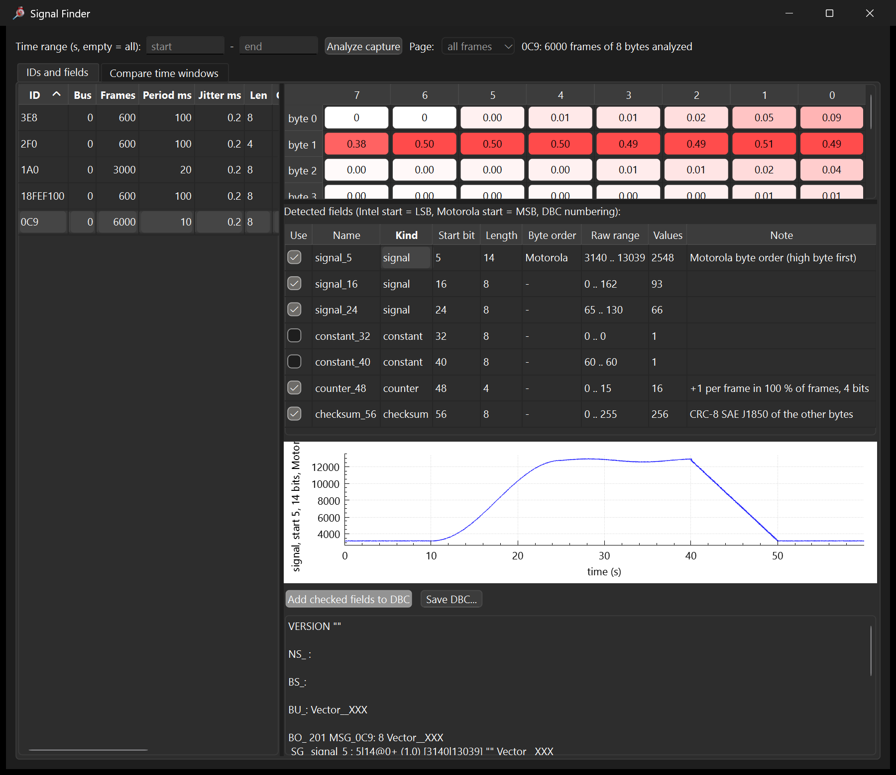
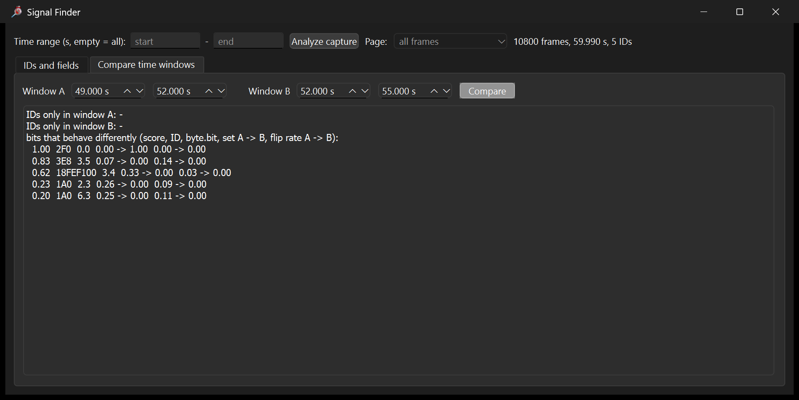
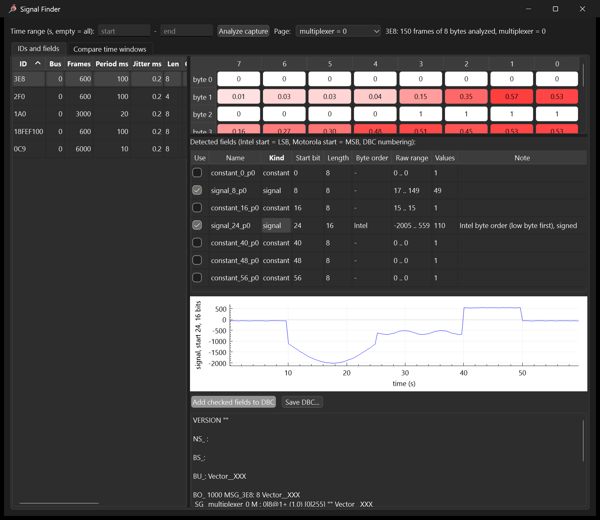
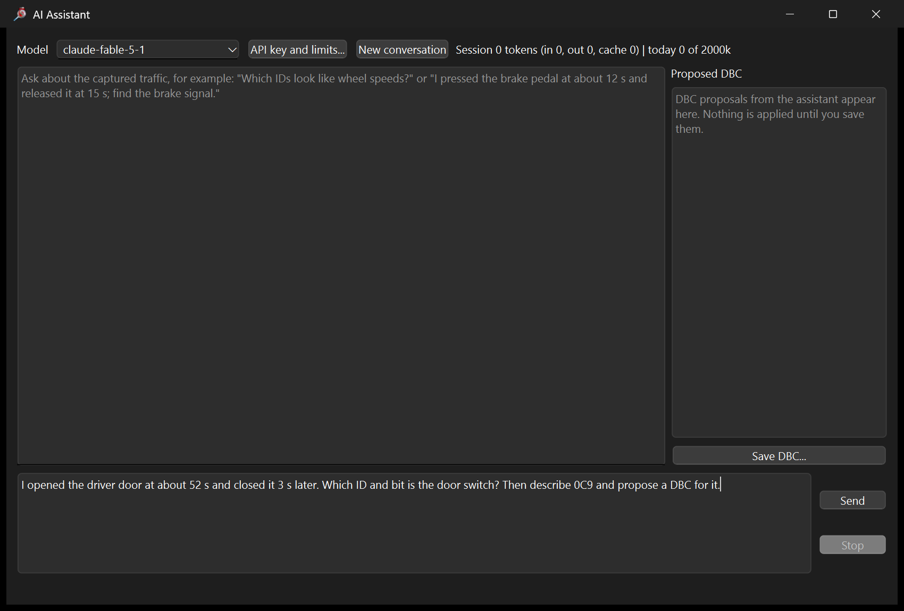
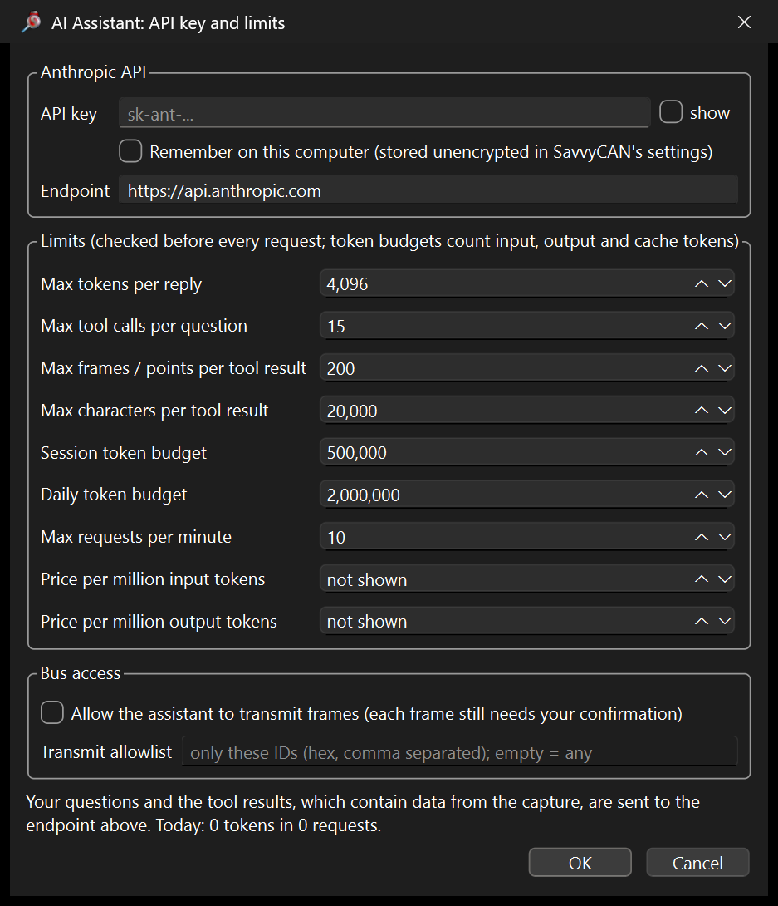

# Reverse engineering CAN traffic

This guide shows how to find out what an unknown CAN bus carries:
which IDs hold which values, where the rolling counters and checksums
are, what changes when you press a button, and how to write all of it
down as a DBC file. It uses three tools that share one analysis engine:

| Tool | Where | What for |
|---|---|---|
| **Signal Finder** | SavvyCAN, RE Tools menu | Look at the capture yourself: heatmap, detected fields, plots, window comparison, DBC export |
| **AI Assistant** | SavvyCAN, RE Tools menu | Ask questions in plain language; Claude runs the same analysis as tools and proposes a DBC |
| **`canre_cli`** | `tools/canre/` | The assistant's tools on the command line, for scripts and for checking an answer |

Everything here can be tried without a car: `tools/re_demo.py` writes a
minute of simulated vehicle traffic whose layout is known, so you can
compare every result with the truth.

* [1. Get a capture](#1-get-a-capture)
* [2. A first look](#2-a-first-look)
* [3. Signal Finder](#3-signal-finder)
* [4. What changed when I pressed the button](#4-what-changed-when-i-pressed-the-button)
* [5. Multiplexed messages](#5-multiplexed-messages)
* [6. AI Assistant](#6-ai-assistant)
* [7. AI Assistant examples](#7-ai-assistant-examples)
* [8. canre_cli](#8-canre_cli)
* [9. How the analysis works, and its limits](#9-how-the-analysis-works-and-its-limits)

## 1. Get a capture

### The demo capture

```sh
python3 tools/re_demo.py demo.log              # 10800 frames, 60 s, candump format
python3 tools/re_demo.py --print-dbc > demo.dbc  # the answer key
```

The simulated car drives a fixed scenario:

| Time | What happens |
|---|---|
| 0 - 10 s | idle, low beam on from 5 s |
| 10 - 25 s | accelerating to about 80 km/h |
| 25 - 40 s | cruising, left turn signal blinks 30 - 34 s |
| 40 - 50 s | braking to a stop (brake switch on) |
| 52 - 55 s | driver door open |

and sends five IDs:

| ID | Period | Content (the answer key) |
|---|---|---|
| `0C9` | 10 ms | engine: RPM (16 bit Motorola, 0.25 rpm), throttle, coolant temperature, two constant bytes, 4-bit rolling counter, CRC-8 SAE J1850 |
| `1A0` | 20 ms | four wheel speeds, 16 bit Intel, 0.01 km/h |
| `2F0` | 100 ms | body flags: driver door, passenger door, low beam, left turn lamp |
| `3E8` | 100 ms | battery, multiplexed by byte 0: pack voltage and signed current (page 0), cell temperatures (1), state of charge (2), serial number (3) |
| `18FEF100` | 100 ms | J1939 CCVS (extended ID): vehicle speed 1/256 km/h, brake switch |

Load `demo.log` in SavvyCAN with File > Load Log File, or play it onto
a real bus with `canplayer -I demo.log` (Linux), or send it live:
`python3 tools/re_demo.py --live can0`.

### A real capture

Capture with SavvyCAN (connected to the bus, see
[the SavvyCAN guide](savvycan-guide.md)) or with `candump -l any` on
Linux. A few habits make the analysis much easier:

* **Start with a quiet baseline.** Record 10 - 20 s with nothing
  happening before you do anything.
* **Do one thing at a time and write down when.** "Door open at 52 s,
  closed at 55 s" is what the window comparison and the assistant need.
  SavvyCAN's timestamps start at the first frame; note the time shown in
  the frame list, or keep a stopwatch running from the start.
* **Repeat it.** Open the door three times; a real switch follows every
  time, noise does not.
* **Sweep a value slowly.** Turn the steering wheel lock to lock, press the
  pedal slowly from 0 to 100 %: a signal that follows is easy to find,
  and its range tells you the scaling.
* **Listen only** when you are not sure the bus tolerates another node
  (connection window, Listen Only). The analysis needs nothing else.

Captures can contain identifying data such as the VIN or key IDs. Keep
that in mind before you share a log or send it to the AI Assistant.

## 2. A first look

Open RE Tools > Signal Finder. The left table lists every ID with its
frame count, period, jitter, length and the number of bytes that change.
The same overview from the command line:

```text
$ canre_cli demo.log list_ids sort=changing
id        bus  count  period_ms  jitter_ms  len  changing_bytes  distinct_payloads
1A0         0   3000       20.0        0.2  8                 8               1000
0C9         0   6000       10.0        0.2  8                 6               1000
3E8         0    600      100.0        0.2  8                 5                147
18FEF100    0    600      100.0        0.2  8                 3                393
2F0         0    600      100.0        0.2  4                 1                  4
```

How to read it:

* **Period and jitter**: a fixed period with little jitter is a cyclic
  message from one ECU. Event messages (diagnostics, button presses)
  show long, irregular periods.
* **Changing bytes**: 0 means a status message that never changed during
  the capture; do something to the car and compare.
* **Distinct payloads**: few payloads (`2F0`: 4) means flags and states;
  many (capped at 1000) means measured values, counters or checksums.

## 3. Signal Finder

Click an ID. Signal Finder analyzes all its frames and shows:

* **the bit flip heatmap** (top): for every bit, how often it changes
  from one frame to the next. Inside a measured value the rate rises from
  the most to the least significant bit; a rolling counter shows 1.00,
  0.50, 0.25, 0.12 in its low bits; a checksum is about 0.50 everywhere;
  constant bits are white.
* **detected fields** (middle), each with kind, DBC start bit, length,
  byte order, raw range, number of values and a note:
  * *counter*: steps by +1 (mod 2^n) in at least 90 % of frames;
  * *checksum*: XOR, SUM, CRC-8 SAE J1850 or CRC-8 AUTOSAR (0x2F) of the
    other bytes, also with a constant offset;
  * *constant*, *flag* (single bit), *signal* (multi-bit value, with
    byte order, and "signed" when the values lie around zero);
  * *multiplexer*: see [section 5](#5-multiplexed-messages).
* **a plot** (bottom) of the field selected in the table, over time.



On `0C9` the analysis finds the whole layout except the names: RPM as a
14-bit Motorola field from bit 5 (raw 3140 .. 13039; the two top bits are
never set at these speeds), throttle, coolant temperature, the two
constant bytes, the 4-bit counter and the CRC-8 J1850 checksum. The plot
of the RPM field shows the drive: idle, acceleration from 10 s, cruise,
braking from 40 s.

### From fields to a DBC

1. Untick what you do not want, and rename the rest in the Name column
   (`signal_5` becomes `EngineRPM`).
2. Press **Add checked fields to DBC**. The DBC text below grows with
   every ID you add.
3. **Save DBC...** writes the file and offers to load it into SavvyCAN.
   Tick **Interpret Frames** in the main window and the frame list shows
   the decoded values.

Scaling (factor, offset, unit) cannot be read from the bits alone. Find
it from a known value: if the dashboard shows 800 rpm at idle and the raw
value is about 3200, the factor is 0.25. Edit factor and unit in the
saved DBC, or in SavvyCAN's DBC editor.

Fields reach only as far as the bits that changed. The wheel speeds of
`1A0` come out as 13-bit fields because the top three bits stay 0 below
82 km/h; on page 2 of `3E8` only the two low bits of the state of charge
moved in one minute. Extend such a field to the whole byte or word
when you know what it is.

## 4. What changed when I pressed the button

The **Compare time windows** tab compares two time ranges, typically
"before" and "while" you did something. It lists IDs that appear or
vanish, IDs whose rate changed, and the bits that behave differently,
ranked:

* a bit that is steady in both windows but at a different level (a
  switch, a state) scores highest;
* a single bit at rest in one window and toggling in the other (a
  blinking lamp, a repeating button) comes next;
* bits of values that merely drift rank lower.

Door opened at 52 s in the demo: window A 49 - 52 s, window B 52 - 55 s.



`2F0` byte 0 bit 0 went from never set to always set: the door switch.
The lines below it are the end of braking (the car stops at 50 s).

The left turn signal, 26 - 30 s against 30 - 34 s:

```text
$ canre_cli demo.log compare_windows a_start=26 a_end=30 b_start=30 b_end=34 max_bits=6
...
bits that behave differently (score, ID, byte.bit, set A -> B, flip rate A -> B):
  0.91  2F0  0.5  0.00 -> 0.50  0.00 -> 0.18
  0.84  0C9  3.3  0.84 -> 0.00  0.00 -> 0.00
  0.84  0C9  3.4  0.16 -> 1.00  0.00 -> 0.00
  0.64  18FEF100  2.4  1.00 -> 0.33  0.00 -> 0.03
  ...
```

The blinking lamp (`2F0` bit 5: set half of the time, toggling) is on
top. The two `0C9` byte 3 bits below it are the coolant temperature
crossing a bit boundary as it warms up, a reminder to check a candidate
with a second event before believing it.

## 5. Multiplexed messages

Some IDs carry several layouts in turn: a byte (the multiplexer, or page
selector) says which. Signal Finder recognises one when the other bytes
rarely change between frames with the same value of it, and reports it
as *multiplexer* with its values. Pick a value in the **Page** list to
analyze only those frames; fields added from a page go into the DBC as
multiplexed signals (`M` and `m<n>`), which SavvyCAN decodes.



On `3E8` page 0 the analysis finds the voltage (low byte; the high byte
is a constant 0x0F here, so extend the field to 16 bits) and the current
as a signed 16-bit Intel value from -2005 to 559 raw: the battery
discharges while accelerating and charges (regenerates) while braking.

```text
$ canre_cli demo.log analyze_id id=3E8
...
  multiplexer start  0 len  8 Intel    raw 0..3, 4 values, selects the layout of the other bytes (change ratio 0.12); values 0 1 2 3; analyze each value separately
$ canre_cli demo.log analyze_id id=3E8 mux_start=0 mux_length=8 mux_value=0
...
  signal   start 24 len 16 Intel    raw -2005..559, 110 values, Intel byte order (low byte first), signed
```

Without the page filter the fields of all pages mix: the same bits of
`3E8` analyzed over all frames give a meaningless 0 .. 65496.

## 6. AI Assistant

RE Tools > AI Assistant is a chat with Claude (Anthropic) that works on
the capture loaded in SavvyCAN. You ask in plain language; Claude calls
the analysis as tools, reads the results and answers, and can propose
DBC signals that you review and save.



The window, its limits and the tool loop have been tested against a
local mock of the Anthropic Messages API that checks every request; a
run against the real service needs your key.

### Setting it up

You need an Anthropic API key (console.anthropic.com). Press
**API key and limits...**:



* **API key**: kept for this session only, unless you tick *Remember*
  (then it is stored unencrypted in SavvyCAN's settings file). Without a
  key here, the `ANTHROPIC_API_KEY` environment variable is used.
* **Endpoint**: `https://api.anthropic.com`, or a compatible proxy.
* **Model** (main window): `claude-fable-5-1` by default; the list also
  offers `claude-opus-5-5`, `claude-sonnet-5-5` and `claude-haiku-5-5`.
  Smaller models are cheaper and fine for simple questions.

### Limits

Every request the assistant makes is checked against limits you set:

| Limit | Default | What it bounds |
|---|---|---|
| Max tokens per reply | 4096 | the length of each answer (`max_tokens`) |
| Max tool calls per question | 15 | how many analysis steps one question may take |
| Max frames / points per tool result | 200 | raw frames and plotted points sent back to Claude |
| Max characters per tool result | 20000 | any single tool result; longer ones are cut |
| Session token budget | 500000 | input + output + cache tokens until you restart or press New conversation |
| Daily token budget | 2000000 | the same per calendar day, kept across restarts |
| Max requests per minute | 10 | the assistant waits when it would exceed it |
| Price per million input / output tokens | not shown | fill in to see an estimated cost |
| Allow the assistant to transmit frames | off | see below |

The budgets are checked before each request, and the reply size is
capped to what is left, so a budget is never overrun by more than one
reply. The counters come from the API's own usage figures. The status
line shows session and daily usage.

For scale: the instructions and tool definitions sent with every request
are about 6,500 characters (roughly 1,600 tokens), cached by the API
after the first request; one `analyze_id` result is about 1,300
characters, a `list_ids` result 500. A question that takes five tool
calls makes six requests, each carrying the conversation so far.

### What leaves your computer

Your questions and the tool results go to the configured endpoint.
Tool results contain data from the capture: IDs, byte statistics and,
for `get_frames` and `signal_values`, raw frames and decoded values.
The capture itself is not uploaded as a file, but whatever the assistant
asks for is. Do not use the assistant on captures you may not share.

### Transmitting

Off by default. When you allow it, the assistant gets a `send_frame`
tool to probe the bus ("send this request and watch the response").
Every frame it wants to send is shown to you with its reason, and you
confirm or refuse it; an allowlist limits the IDs it may use at all.
Sending frames to a vehicle can make it do things: allow it only on a
bench or a test bus.

### The tools Claude uses

| Tool | What it returns |
|---|---|
| `capture_overview` | frame count, duration, buses, number of IDs |
| `list_ids` | the ID table of section 2 |
| `analyze_id` | the Signal Finder analysis of one ID, optionally for a time range or one multiplexer page |
| `get_frames` | raw frames of one ID |
| `signal_values` | a bit field decoded over time (scaled, signed, per page) |
| `compare_windows`, `changes_around` | the window comparison of section 4 |
| `propose_dbc` | puts DBC messages and signals into the Proposed DBC panel; nothing is applied until you save |
| `send_frame` | only when transmitting is allowed; every frame is confirmed |

## 7. AI Assistant examples

The examples below use the demo capture. The **tool results are real**:
they are the output of the analysis on `demo.log`, and `canre_cli`
reproduces each of them. Claude's replies are not reproduced, because
they differ between models and runs. Instead, each example lists the
tool calls a good run makes and what a correct answer has to contain,
so you can judge the reply you get.

### Example 1: "What is on this bus?"

> Give me an overview of this capture. Which IDs look like cyclic sensor
> data, which like status flags, and which have counters or checksums?

Expected tool flow: `capture_overview`, `list_ids`, then `analyze_id` on
the IDs with many changing bytes (`1A0`, `0C9`), often on all five.

```text
capture_overview  ->  10800 frames over 59.990 s, 5 distinct IDs, buses: 0
list_ids          ->  (the table in section 2)
analyze_id 0C9    ->  ...
  signal   start  5 len 14 Motorola raw 3140..13039, 2548 values, Motorola byte order (high byte first)
  signal   start 16 len  8 Intel    raw 0..162, 93 values
  signal   start 24 len  8 Intel    raw 65..130, 66 values
  constant start 32 len  8 Intel    raw 0..0, 1 values
  constant start 40 len  8 Intel    raw 60..60, 1 values
  counter  start 48 len  4 Intel    raw 0..15, 16 values, +1 per frame in 100 % of frames, 4 bits
  checksum start 56 len  8 Intel    raw 0..255, 256 values, CRC-8 SAE J1850 of the other bytes
```

A correct answer says that `0C9` (10 ms) has a counter in the low nibble
of byte 6 and a CRC-8 J1850 in byte 7; that `1A0` holds four similar
16-bit Intel values (likely wheel speeds); that `2F0` is a flag byte;
that `3E8` is multiplexed by byte 0; and that `18FEF100` is a J1939 PGN
(FEF1, CCVS: vehicle speed). It should present the meanings as
hypotheses until checked.

### Example 2: "Find the door switch"

> I opened the driver door at about 52 s and closed it 3 s later. Which
> ID and bit is the door switch?

Expected tool flow: `changes_around` at 52 s, then `get_frames` on the
top candidate to look at the frames around the moment.

```text
changes_around time_s=52 before_s=3 after_s=3
window A 49.000..52.000 s, window B 52.000..55.000 s
IDs only in window A: -
IDs only in window B: -
bits that behave differently (score, ID, byte.bit, set A -> B, flip rate A -> B):
  1.00  2F0  0.0  0.00 -> 1.00  0.00 -> 0.00
  0.83  3E8  3.5  0.07 -> 0.00  0.14 -> 0.00
  0.62  18FEF100  3.4  0.33 -> 0.00  0.03 -> 0.00
  ...
get_frames id=2F0 start_s=51.5 end_s=52.5
   ...
   51.9051 10 80 00 00
   52.0053 11 80 00 00
   ...
```

A correct answer: `2F0` byte 0 bit 0 (DBC start bit 0, length 1), set
from 52.0 s. The other lines are the car coming to a stop (the brake
switch bit `18FEF100` 3.4 goes off at 50 s), not the door. A careful
answer suggests repeating the door event to confirm.

### Example 3: "What is the engine message?"

> Analyze 0C9. What are the fields, and what is the RPM signal's
> scaling if the engine idles at about 800 rpm?

Expected tool flow: `analyze_id 0C9`, then `signal_values` on the
candidate with a factor, to check the idle value.

```text
signal_values id=0C9 start_bit=5 length=14 byte_order=motorola factor=0.25 max_points=13
6000 values, min 785 max 3259.75 mean 1900.81, 5956 changes, >= 1000 distinct
time_s value
0.000 789
9.240 796.5
18.480 2236.5
27.720 3235.75
36.960 3193.75
46.200 1715.25
55.440 795.5
(every second row shown)
```

A correct answer: RPM is a Motorola value ending at the last bit of byte
1 (in a DBC it can be written as 16 bits from start bit 7); a factor of
0.25 gives about 790 rpm at idle and 3260 at the top; byte 2 is a
pedal-like value (0 .. 162, rising with RPM); byte 3 rises slowly (65 ..
130: a temperature with offset -40 is a good guess); byte 6 low nibble
is the counter; byte 7 the CRC-8 J1850 checksum over bytes 0 .. 6.

### Example 4: a multiplexed message

> 3E8 looks like it changes layout every frame. Explain it and decode
> what you can.

Expected tool flow: `analyze_id 3E8` (finds the multiplexer), then
`analyze_id` with `mux_start=0, mux_length=8, mux_value=0` (and 1, 2,
3), then `signal_values` with the same mux parameters.

```text
analyze_id id=3E8 mux_start=0 mux_length=8 mux_value=0
  ...
  signal   start  8 len  8 Intel    raw 17..149, 49 values
  constant start 16 len  8 Intel    raw 15..15, 1 values
  signal   start 24 len 16 Intel    raw -2005..559, 110 values, Intel byte order (low byte first), signed
signal_values id=3E8 start_bit=24 length=16 byte_order=intel signed=true factor=0.1 max_points=13 mux_start=0 mux_length=8 mux_value=0
150 values, min -200.5 max 55.9 mean -49.436, 148 changes, 110 distinct
time_s value
9.608 -5.1
19.208 -195.1
43.208 55.6
57.608 -4.5
(4 of 13 rows shown)
```

A correct answer: byte 0 selects four pages; page 0 has a 16-bit value
at bytes 1 - 2 (0x0F in the high byte, about 3960 raw: a pack voltage of
396 V at 0.1 V) and a signed 16-bit value at bytes 3 - 4 that is large
and negative while accelerating and positive while braking (a battery
current, discharge negative, charge from regeneration positive); page 1
four similar slowly rising bytes (temperatures); page 2 one slowly
falling byte (state of charge); page 3 constant (an identifier or serial
number).

### Example 5: from findings to a DBC

> Propose a DBC for 0C9 and the door, turn signal and low beam flags of
> 2F0, with the scalings you are confident about.

Expected tool flow: whatever is not known yet, then `propose_dbc`. The
proposal appears in the Proposed DBC panel, for example:

```text
BO_ 201 Engine: 8 Vector__XXX
 SG_ EngineRPM : 7|16@0+ (0.25,0) [0|16383.75] "rpm" Vector__XXX
 SG_ Throttle : 16|8@1+ (1,0) [0|255] "" Vector__XXX
 SG_ Coolant : 24|8@1+ (1,-40) [-40|215] "degC" Vector__XXX
 SG_ Counter : 48|4@1+ (1,0) [0|15] "" Vector__XXX
 SG_ Checksum : 56|8@1+ (1,0) [0|255] "" Vector__XXX

BO_ 752 Body: 4 Vector__XXX
 SG_ DriverDoor : 0|1@1+ (1,0) [0|1] "" Vector__XXX
 SG_ LowBeam : 4|1@1+ (1,0) [0|1] "" Vector__XXX
 SG_ TurnLeft : 5|1@1+ (1,0) [0|1] "" Vector__XXX
```

Nothing changes until you press **Save DBC...**, which also offers to
load the file into SavvyCAN. Compare it with the answer key from
`re_demo.py --print-dbc`: the throttle's 0.4 %/bit cannot be known from
the capture alone, so a good proposal leaves it raw or says it guessed.

### Writing good questions

* **Give times.** "At about 52 s" lets the assistant use
  `changes_around` instead of reading frames.
* **Say what you did and what you expect.** "I turned the steering wheel
  fully left, then fully right" points it to a signed value that sweeps.
* **Name known values.** "The dashboard showed 50 km/h at 20 s" lets it
  find the scaling.
* **Ask for verification.** "Check it with signal_values" makes it test
  a hypothesis instead of stating it.
* **Keep questions narrow on big captures.** "Only IDs below 0x400" or
  "between 30 and 40 s" keeps tool results, and tokens, small.

## 8. canre_cli

`tools/canre/canre_cli` runs any of the assistant's tools on a candump
log, with the same arguments as the tool definitions. It prints exactly
what Claude would receive, which helps to check an answer, to script the
analysis, or to use it without the GUI.

```sh
make -C tools/canre
tools/canre/canre_cli demo.log capture_overview
tools/canre/canre_cli demo.log list_ids sort=changing
tools/canre/canre_cli demo.log analyze_id id=0C9
tools/canre/canre_cli demo.log analyze_id id=3E8 mux_start=0 mux_length=8 mux_value=0
tools/canre/canre_cli demo.log signal_values id=1A0 start_bit=0 length=16 byte_order=intel factor=0.01 max_points=12
tools/canre/canre_cli demo.log changes_around time_s=52 before_s=3 after_s=3
tools/canre/canre_cli demo.log compare_windows a_start=26 a_end=30 b_start=30 b_end=34
tools/canre/canre_cli demo.log get_frames id=2F0 start_s=51.5 end_s=52.5
```

Arguments are `name=value`; `id`, `sort` and `byte_order` are text,
`true`/`false` are flags, everything else is a number. `max_chars=N` and
`max_frames=N` set the result limits (defaults 20000 and 200, as in the
assistant). It builds with any C++17 compiler (g++, clang, MinGW); the
input is a candump log (`candump -l`, `re_demo.py`, or SavvyCAN's File >
Save Log File in candump format).

## 9. How the analysis works, and its limits

The analysis (`gui/savvycan/re/canre.h`) needs no Qt and is unit tested
on synthetic captures (`tests/gui/canre_test.cpp`). Per ID:

1. **Statistics** per byte (range, distinct values, changes, entropy) and
   per bit (flip rate, share of frames with the bit set).
2. **Checksums**: a byte equal to XOR, SUM, CRC-8 SAE J1850 (0x1D) or
   CRC-8 AUTOSAR (0x2F) of the other bytes, possibly with a constant, in
   98 % of frames. Counter-like bytes are skipped.
3. **Counters**: a byte, nibble or 2 - 3 bit field stepping +1 modulo its
   size in 90 % of frames, unless it is the low part of a ramp.
4. **Multiplexer**: a byte or nibble with 2 .. 32 values such that the
   other bytes rarely change between frames with the same value (ratio of
   change rates below 0.5); between candidates that split the frames the
   same way, the coarsest one that explains the layout as well wins.
5. **Signals**: the remaining bits are segmented after READ (Marchetti
   and Stabili, 2018): inside a value the flip rate rises from MSB to LSB,
   so a boundary lies where it falls by an order of magnitude. Both byte
   orders are tried; a multi-byte field whose upper part does not carry
   when its low byte wraps is two separate values. Values on both sides of
   zero that lie close in two's complement are signed.
6. **Window comparison**: per bit, the change in level and in toggle rate
   between the two windows.

Limits worth knowing:

* Only bits that changed in the capture are found; widen fields by hand
  (section 3).
* Scaling, units and meaning come from you (or the assistant's
  reasoning), not from the bits.
* Checksums other than the four listed (CRC-16, CRCs with data IDs as in
  AUTOSAR E2E profiles, proprietary ones) are reported as noisy signals.
* A byte holding several short values (two nibbles of unrelated signals)
  may be read as one field.
* Values that are constant during the capture look like constants: do
  something to the car to make them move.
* The window comparison ranks evidence; it does not prove meaning.
  Repeat the action and compare again.
