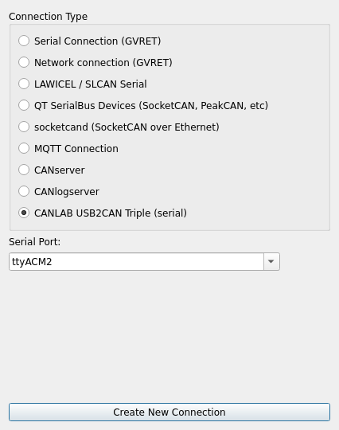
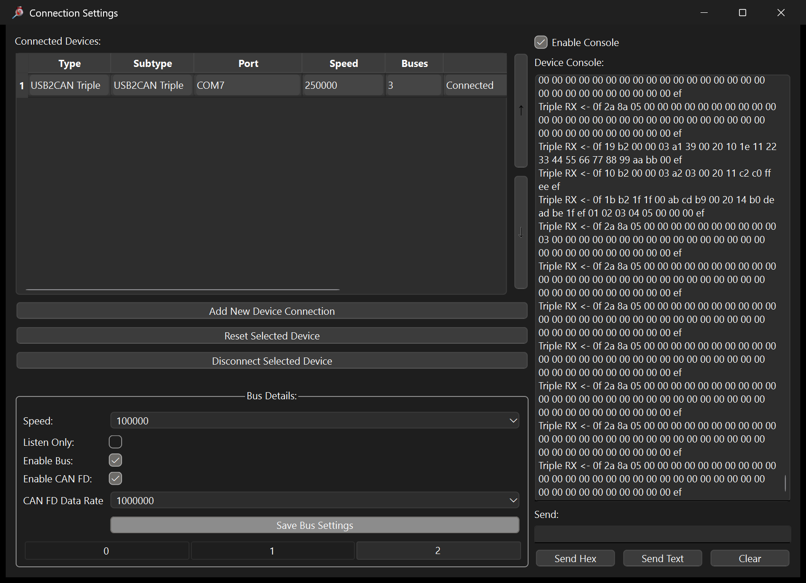
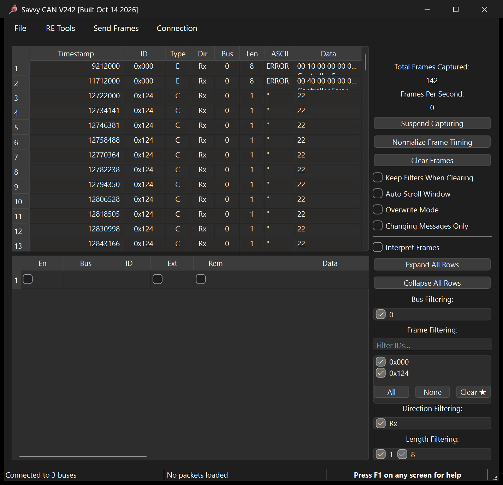
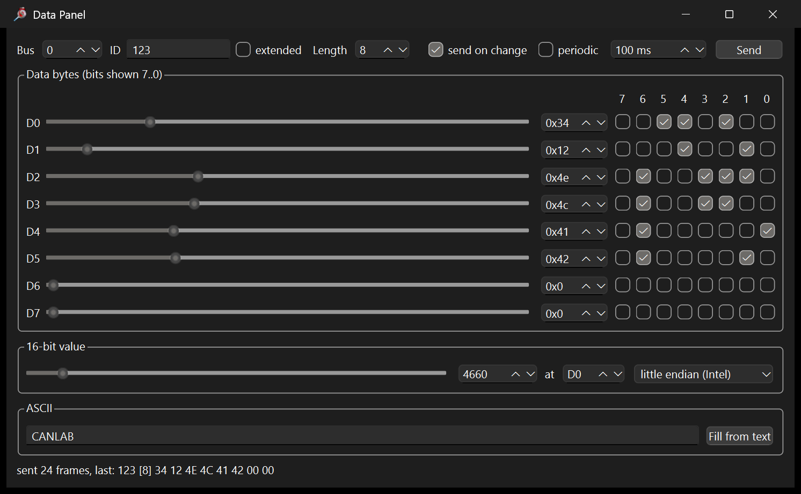
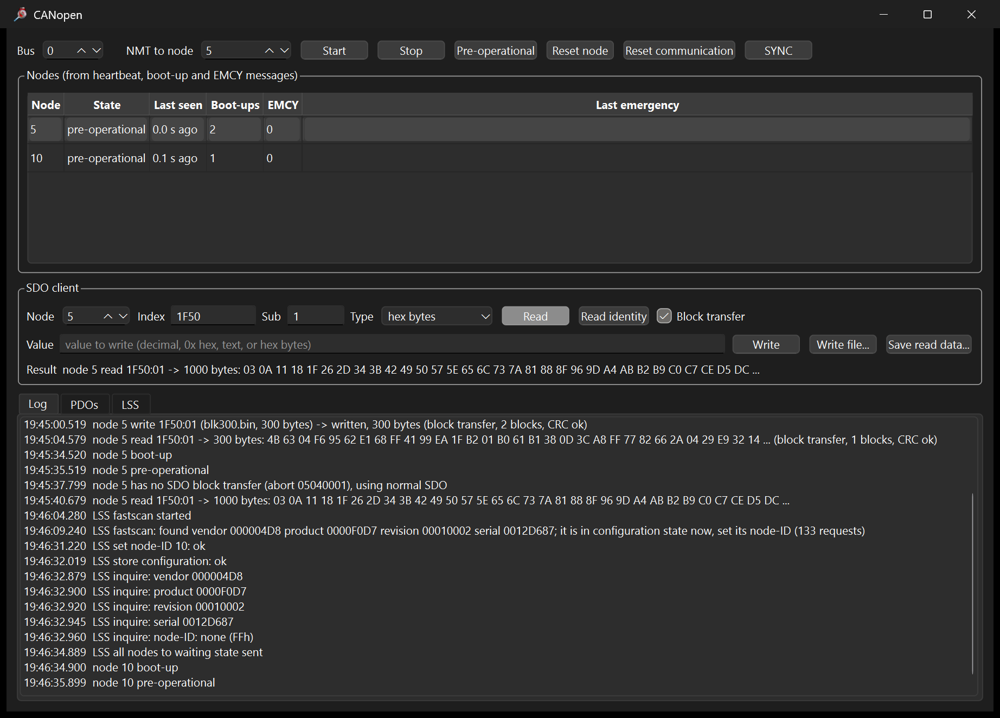
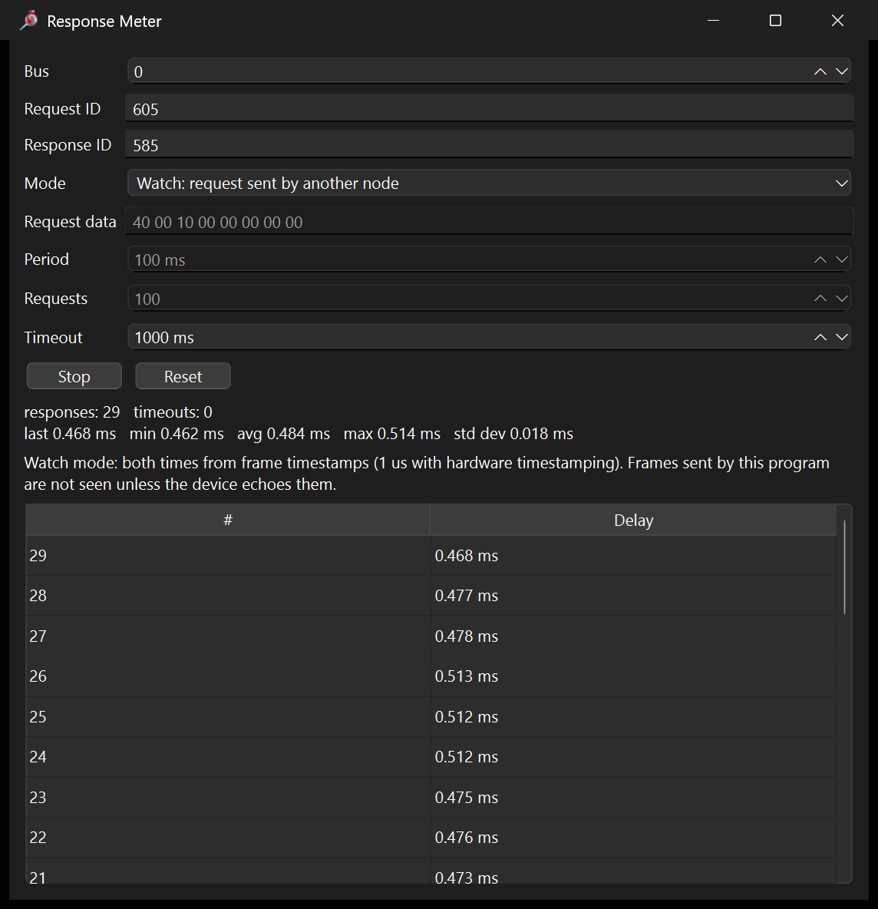
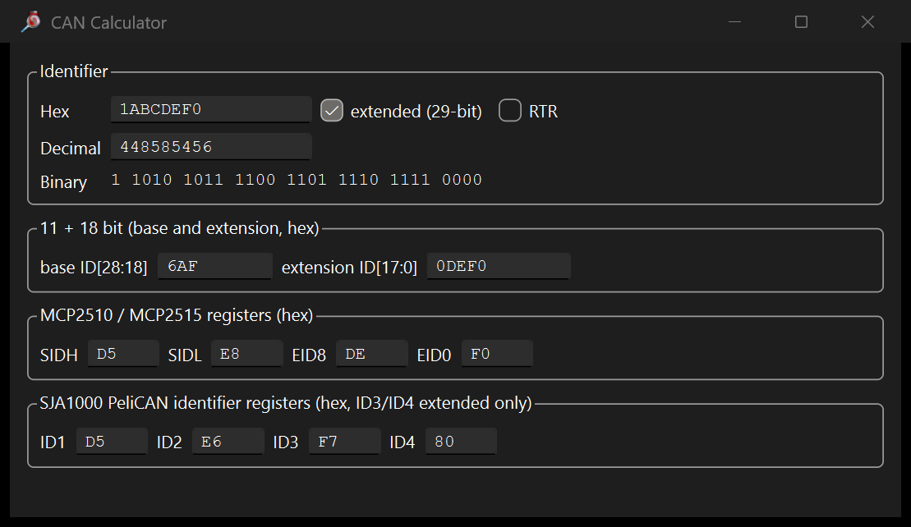
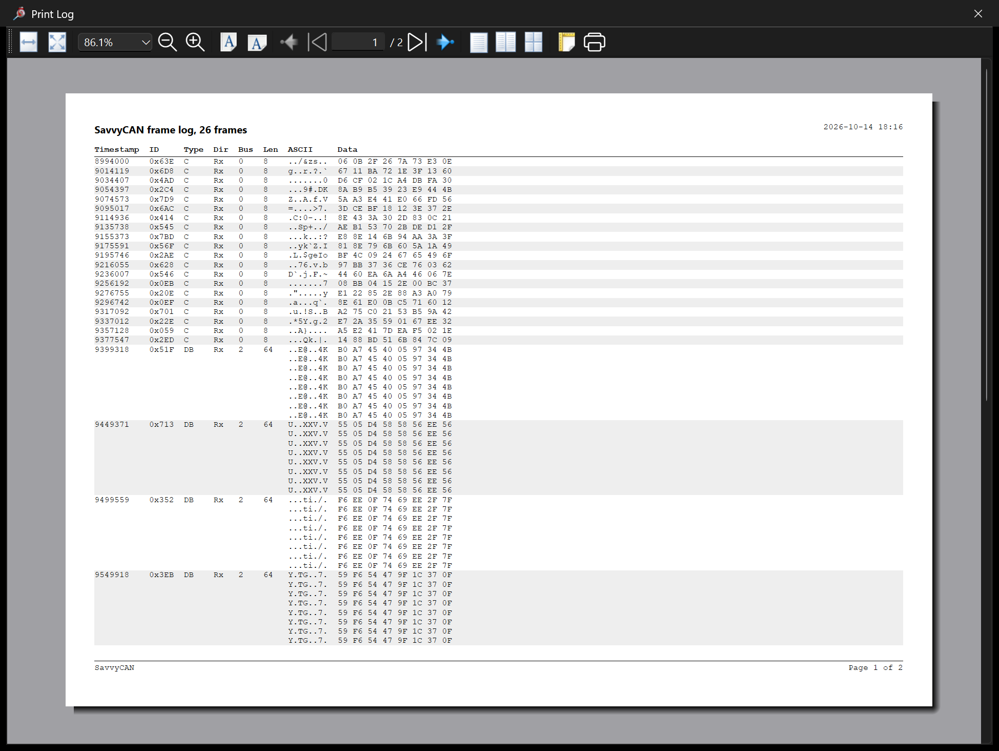

# SavvyCAN with the USB2CAN Triple: user guide

[SavvyCAN](https://github.com/collin80/SavvyCAN) is an open source CAN
bus analyzer. This repository adds to it a native connection for the
CANLAB USB2CAN Triple and a set of tools, most of them modelled on
PP2CAN and useful with any CAN interface:

| Menu | Tool | Section |
|---|---|---|
| Connection | USB2CAN Triple connection (3 buses, CAN FD, hardware timestamps) | [2](#2-connect-an-adapter) |
| RE Tools | Bus Statistics | [5](#5-bus-statistics) |
| RE Tools | CANopen (NMT, SDO incl. block transfer, PDOs from EDS, LSS) | [6](#6-canopen) |
| RE Tools | Signal Finder, AI Assistant | [Reverse engineering guide](reverse-engineering.md) |
| RE Tools | Response Meter, CAN Calculator | [7](#7-response-meter-and-can-calculator) |
| Send Frames | Data Panel | [4](#4-send-frames) |
| File | PP2CAN log files, Print Log | [3](#3-capture-and-view), [8](#8-print-a-log) |

Everything else (DBC decoding, graphs, scripting, ISO-TP / UDS, replay,
filters) is SavvyCAN's own; see its
[repository](https://github.com/collin80/SavvyCAN) and the in-program
help (F1 on any window).

## 1. Install

SavvyCAN is built from source with the changes applied:

* **Windows**: Qt 6.8 with MinGW, SavvyCAN's `QT6WIP` branch.
* **Linux**: Qt 5.15 from the distribution, SavvyCAN `master`.

The steps are in [gui/savvycan/README.md](../gui/savvycan/README.md#build).
In short:

```sh
git clone https://github.com/collin80/SavvyCAN              # Linux (master, Qt 5)
git clone --branch QT6WIP https://github.com/collin80/SavvyCAN  # Windows (Qt 6)
python3 gui/savvycan/apply.py SavvyCAN
# then build with qmake (Qt 5) or CMake (Qt 6)
```

The adapter needs no driver on Windows (it uses the built-in
`usbser.sys` and appears as `COMx`), on Linux it is `/dev/ttyACMx`
(macOS should work the same way as `/dev/cu.usbmodem*`, untested). SavvyCAN talks to it over the serial port
directly: the Linux kernel module is not needed, and the port cannot be
shared with it (stop `ldattach` first).

## 2. Connect an adapter

Connection > Open Connection Window > **Add New Device Connection**,
choose **CANLAB USB2CAN Triple (serial)** and the port (Triple adapters
are listed first), then **Create New Connection**.



The device shows three buses:

| Bus | Port | Type |
|---|---|---|
| 0 | CAN1 | classic CAN |
| 1 | CAN2 | classic CAN |
| 2 | CAN3 | CAN FD (classic frames too) |

Select a bus tab under **Bus Details** (0, 1, 2), set its speed, Listen
Only and, for bus 2, Enable CAN FD and the data rate, then press **Save
Bus Settings** (the device row must be selected).



* Defaults: CAN1 250 kbit/s, CAN2 500 kbit/s, CAN3 FD 125 kbit/s
  nominal, 6.7 Mbit/s data.
* CAN1 and CAN2 take the firmware's rates: 10k, 20k, 33.3k, 50k, 62.5k,
  83.3k, 100k, 125k, 250k, 500k, 1M.
* CAN3 takes 125k, 250k, 500k, 1M nominal with 250k .. 10M data from the
  firmware's table; any other pair (100 kbit/s nominal, for example) is
  sent as raw controller timing with 80 % sample points, which matches
  other Triples and PP2CAN.
* **Enable Console** shows every message exchanged with the adapter, the
  firmware version and the error counters.
* SavvyCAN can save connections and restore them at the next start
  (Preferences).

Data is received with the adapter's 1 µs hardware timestamps.

### Bus errors and lost frames

The connection turns the adapter's status (every 250 ms) into error
frames in the frame list:

* a **controller error frame on every bus state change** (error warning,
  error passive, bus off, back to error active), with TEC and REC in
  data bytes 6 and 7;
* an **RX overflow** error frame when the adapter's path to the PC was
  overloaded and frames were lost (roughly beyond 2000 .. 5000 frames/s
  per adapter);
* a **TX overflow** error frame when the adapter's transmit buffer was
  full and frames you sent were dropped. SavvyCAN does not pace its
  sending, so this happens when you send faster than the bus takes the
  frames (into a bus without other nodes, or at a high rate on a slow
  bus).



## 3. Capture and view

Frames appear in the main window as they arrive. Useful switches on the
right: **Interpret Frames** (decode with the loaded DBC files),
**Changing Messages Only**, ID / bus / length filters, **Suspend
Capturing**.


Logs:

* **File > Save Log File** writes the capture in SavvyCAN's formats,
  including candump (`.log`), which `canplayer` and the reverse
  engineering tools read.
* **File > Load Log File** reads them back, autodetecting the format,
  including **PP2CAN `.log` files**.
* **File > Save Log as PP2CAN...** writes the capture in PP2CAN's format.
  PP2CAN writes time fields without zero padding ("45.4" is 45 s and
  4 ms); both directions handle that.

## 4. Send frames

* The frame grid below the frame list sends single frames. SavvyCAN
  reads unprefixed numbers as **decimal** there: type `0x7AB` and
  `0x11 0x22`, not `7AB` and `11 22`. CAN FD frames go out on bus 2 only.
* **Send Frames > Custom** is SavvyCAN's periodic sender with triggers
  and modifiers.
* **Send Frames > Playback** replays a log, PP2CAN logs included, so it
  works as PP2CAN's file sender.


* **Send Frames > Data Panel** edits one frame by sliders, hex values
  and bit check boxes per byte, a 16-bit value in Intel or Motorola
  order, or ASCII text, and sends it on every change and/or periodically.



The adapter's messages are limited to 100 bytes on the wire: a 64-byte
CAN FD frame with many data bytes equal to 0x0F, 0x1F or 0xEF (which
need escaping) is refused with a console message, because longer
messages lock up the firmware.

## 5. Bus Statistics

RE Tools > **Bus Statistics** shows per bus: bitrate, data rate,
frames/s, bus load (current and peak) with a graph over time, frames,
error frames, **overflows** (frames lost in the adapter, from the error
frames above), and the bus state with TEC and REC. It works with every
SavvyCAN connection; bitrates come from the connection settings.


The load is the bus time of the observed frames without bit stuffing, a
lower bound. Frames sent by SavvyCAN count only if the device echoes
them.

## 6. CANopen

RE Tools > **CANopen** works with any connection.


* **Nodes**: built from heartbeat, boot-up and EMCY messages, with the
  NMT state and EMCY codes in plain text.
* **NMT**: start, stop, pre-operational, reset node, reset communication,
  to one node or all (node-ID 0); **SYNC** sends one SYNC message.
* **SDO client**: read and write any object, expedited and segmented,
  abort codes in plain text; **Read identity** reads 1000, 1008, 1009,
  100A and 1018. Tick **Block transfer** for large objects (CRC checked;
  falls back to normal SDO if the node does not support it). **Write
  file...** writes a file to an object, **Save read data...** saves what
  was read.
* **PDOs** tab: load the node's EDS or DCF file, or read the mapping from
  the node over SDO, and every mapped object is decoded live with its
  value (by EDS data type), raw bits, frame count and period.


* **LSS** tab (CiA 305): find nodes without a node-ID by fastscan, select
  by identity, inquire, set node-ID and bit timing, activate and store.



To try it without a CANopen device, run the simulated node on a Linux
SocketCAN interface on the same bus:

```sh
python3 tools/canopen_sim.py can0 --node 5               # EDS: tools/canopen_sim.eds
python3 tools/canopen_sim.py can0 --node 255 --serial 1234567   # unconfigured, for LSS
python3 tools/canopen_sim.py can0 --node 6 --no-block    # without block transfer
```

Press Start (NMT) to make it send PDOs.

## 7. Response Meter and CAN Calculator

**Response Meter** (RE Tools) measures the delay between a request ID
and a response ID: from the frame timestamps of traffic on the bus
(watch mode; with the Triple's hardware timestamps the resolution is
microseconds) or by sending the request periodically itself.



**CAN Calculator** (RE Tools) converts an identifier between 29-bit,
11+18 bit, MCP2510/2515 register values (SIDH, SIDL, EID8, EID0) and
SJA1000 registers (ID1 .. ID4); every field is editable.



## 8. Print a log

**File > Print Log** prints the frame list as shown (visible columns in
screen order, current filters), or only the selected frames, through a
print preview: landscape, columns fitted to the page, long CAN FD data
wrapped, with title, date and page numbers. To get a PDF, choose
Microsoft Print to PDF (Windows) or Print to File (Linux) as printer.



## 9. Reverse engineering

**Signal Finder** and the **AI Assistant** (RE Tools) find counters,
checksums, signals and multiplexers, compare time windows and write DBC
files; the assistant does the same through Claude with limits you set.
See the [reverse engineering guide](reverse-engineering.md), which
includes a simulated capture to practise on.


## 10. Troubleshooting

| Symptom | Cause, fix |
|---|---|
| The port does not open | Another program has it: the Linux kernel driver (`pkill ldattach`), PP2CAN, a terminal. On Windows after usbipd: replug the adapter. |
| Nothing received | Wrong bitrate or no other node on the bus. The console shows status messages every 250 ms; TEC/REC rising means bit errors. Try Listen Only first. |
| Bus goes error passive when sending | No other node acknowledges the frames, or the bitrate differs. |
| CAN FD frames not received | CAN FD is on bus 2 only; Enable CAN FD and the data rate must match the bus. Both sample points at 80 % match other Triples and PP2CAN. |
| RX overflow error frames | More traffic than the adapter forwards to the PC; filter at the source or use a second adapter per bus. |
| TX overflow error frames | Sending faster than the bus takes the frames; lower the rate. |
| Grid sends wrong ID or data | Numbers without `0x` are decimal in the frame grid. |
