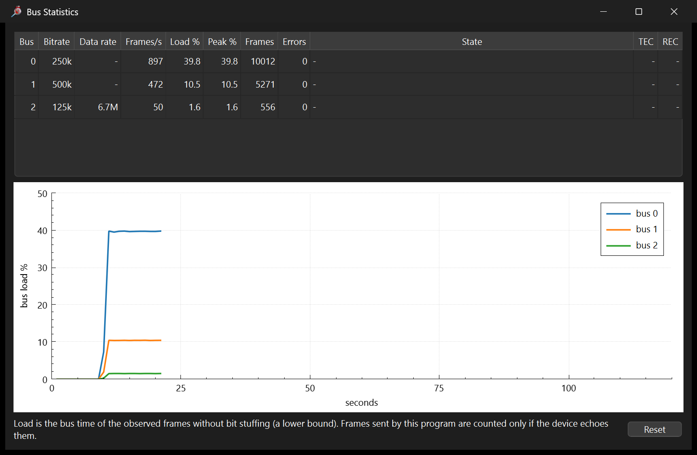
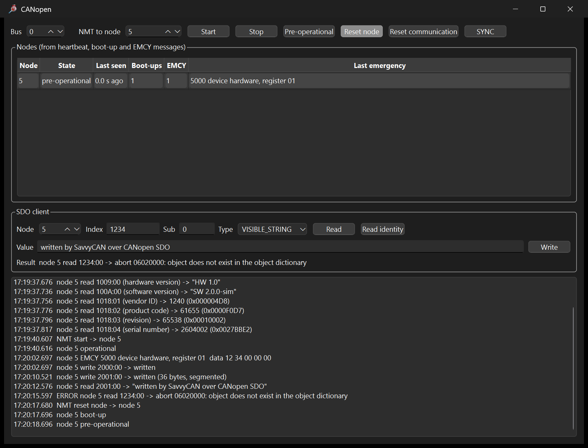
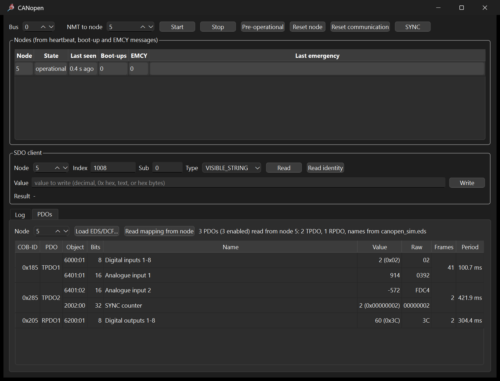
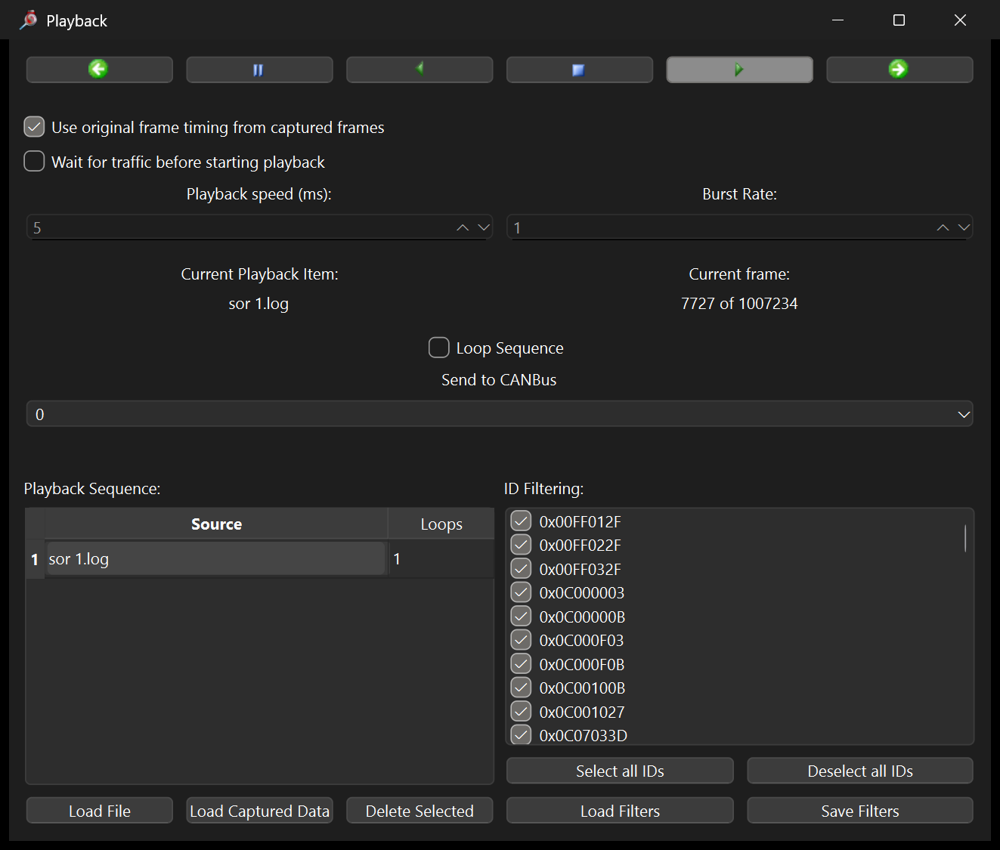
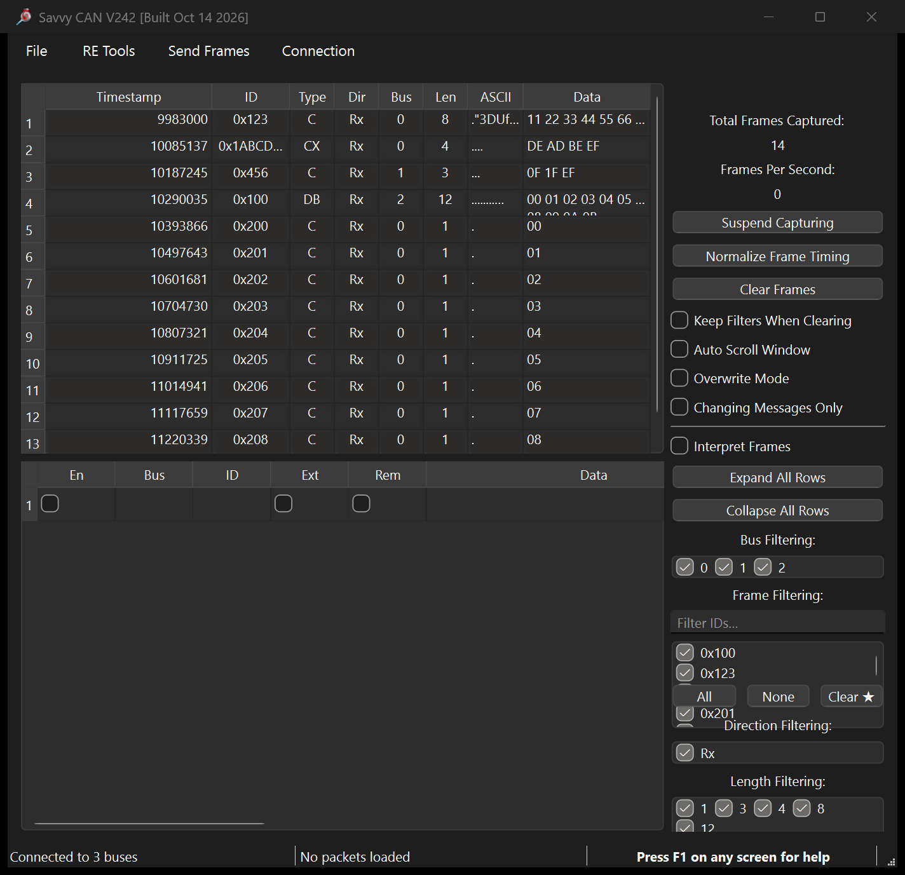

# SavvyCAN with the USB2CAN Triple

[SavvyCAN](https://github.com/collin80/SavvyCAN) is an MIT-licensed Qt
CAN bus analyzer (multi-bus log, DBC decoding, graphing, replay, frame
sender with scripting, ISO-TP / UDS tools). This directory adds a native
connection type for the CANLAB USB2CAN Triple, talking to the adapter over
its serial port with the shared protocol codec, on Linux, Windows and
macOS, without the kernel module.

What the connection provides:

* three buses per adapter (CAN1, CAN2 classic, CAN3 CAN FD), bitrates,
  listen-only, FD data rate and non-ISO set from SavvyCAN's connection
  window (Bus Details tabs 0, 1, 2);
* receive with the adapter's 1 us hardware timestamps, transmit on all
  three buses, CAN FD with BRS on bus 2;
* adapter error counters and error state in the device console, and an
  error frame in the frame list on every bus state change (warning,
  passive, bus off, back to active) with TEC/REC in bytes 6 and 7;
* the adapter's 100-byte message limit enforced on transmit;
* a Bus Statistics window (RE Tools menu): load % per bus with a graph,
  frames/s, error frames, bus state with TEC/REC. It works with every
  SavvyCAN connection, not only the Triple.



* a CANopen window (RE Tools menu): node list from heartbeat, boot-up and
  EMCY messages, NMT commands, SYNC, and an SDO client that reads and
  writes any object (expedited and segmented) and shows abort codes in
  plain text; "Read identity" reads 1000, 1008, 1009, 100A and 1018.
  The PDOs tab decodes PDOs live: load the node's EDS or DCF file, or
  read the mapping from the node over SDO, and every mapped object shows
  its value (by EDS data type), raw bits, frame count and period. Also
  independent of the Triple connection.





* PP2CAN tools:
  * **PP2CAN log files**: File > Load Log File (autodetected) and the
    Playback window read PP2CAN `.log` captures, so Playback works as
    PP2CAN's file sender; File > Save Log as PP2CAN writes the current
    capture in PP2CAN format. Note that PP2CAN writes time fields without
    zero padding ("45.4" is 45 s and 4 ms).
  * **Data Panel** (Send Frames): sliders, hex values and bit check boxes
    per byte, a 16-bit value in Intel or Motorola order, fill from ASCII;
    sends on change and/or periodically.
  * **Response Meter** (RE Tools): delay between a request and a response
    ID, from hardware timestamps (watch mode) or with periodic requests.
  * **CAN Calculator** (RE Tools): identifier as 29-bit, 11+18 and
    MCP2510/2515 or SJA1000 register values, editable in every field.



To try it without a CANopen device, run the simulated node from
`tools/canopen_sim.py` on a Linux SocketCAN interface on the same bus:
`python3 tools/canopen_sim.py can0 --node 5`. Its EDS is
`tools/canopen_sim.eds`; press Start (NMT) to make it send PDOs.

## Apply to an upstream checkout

```sh
git clone https://github.com/collin80/SavvyCAN
python3 gui/savvycan/apply.py SavvyCAN     # copies the sources, edits 8 upstream files
```

`apply.py` is idempotent and works on both upstream lines:

| Upstream | Qt | Build system | Tested commit |
|---|---|---|---|
| `master` | 5.15 | qmake | `e439670` (Linux, WSL2) |
| `QT6WIP` branch | 6.8 | CMake | `3288f1f` (Windows 11, MinGW) |

The connection code compiles against either: master passes `CANFrame`
(a `QCanBusFrame`), QT6WIP its own `CommFrame`, and a small typedef layer
in `triple_serial.h` covers the difference. `savvycan-upstream.patch` is
the change against master as a plain diff.

Files added to `SavvyCAN/connections/`:

| File | Content |
|---|---|
| `triple_serial.h/.cpp` | the `CANConnection` implementation (`CANCon::TRIPLE`) |
| `triple_proto.h/.c` | the protocol codec, copied from `driver/` |

## Build

Linux / WSL2 (Ubuntu 22.04):

```sh
sudo apt install qtbase5-dev qt5-qmake libqt5serialbus5-dev libqt5serialport5-dev \
     qtdeclarative5-dev qttools5-dev libqt5websockets5-dev libqt5opengl5-dev
mkdir SavvyCAN/build && cd SavvyCAN/build
qmake ../SavvyCAN.pro CONFIG+=release && make -j$(nproc)
./SavvyCAN
```

Windows (Qt 6.8 with the MinGW 13.1 kit and the SerialBus / SerialPort
modules, as installed by the Qt online installer):

```bat
git clone --branch QT6WIP https://github.com/collin80/SavvyCAN
python gui\savvycan\apply.py SavvyCAN
set PATH=C:\Qt\Tools\mingw1310_64\bin;C:\Qt\Tools\Ninja;C:\Qt\Tools\CMake_64\bin;C:\Qt\6.8.1\mingw_64\bin;%PATH%
cmake -S SavvyCAN -B SavvyCAN\build -G Ninja -DCMAKE_BUILD_TYPE=Release -DCMAKE_PREFIX_PATH=C:/Qt/6.8.1/mingw_64
cmake --build SavvyCAN\build -j 16
SavvyCAN\build\SavvyCAN.exe
```

To run it outside that shell, collect the Qt DLLs next to the executable
with `windeployqt SavvyCAN.exe`. The adapter appears as `COMx` and uses
Windows' built-in `usbser.sys` driver, so nothing needs installing.

## Use

Connection > Open Connection Window > Add New Device Connection >
"CANLAB USB2CAN Triple (serial)". The port list puts Triple adapters first.
After "Create New Connection" the device shows three buses; select a bus
tab under Bus Details to change bitrate, listen only or (bus 2) CAN FD and
data rate, then "Save Bus Settings". Enable Console shows every message
exchanged with the adapter, the firmware version and the error counters.

Defaults at connect: CAN1 250 kbit/s, CAN2 500 kbit/s, CAN3 FD 125 kbit/s
nominal, 6.7 Mbit/s data, ISO.

SavvyCAN's quick-send grid and frame sender read unprefixed numbers as
decimal: type `0x7AB` and `0x11 0x22`, not `7AB` and `11 22`.

Verified on 2026-10-14 against the Linux kernel driver on a second adapter,
both with SavvyCAN master under WSLg and with the QT6WIP build on
Windows 11: receive on all three buses including CAN FD with BRS, hardware
timestamps, transmit from the frame grid.



If an adapter was attached to WSL2 with usbipd and is handed back to
Windows, Windows may not be able to open its port until it is physically
replugged.

## Limits

* The serial port cannot be shared with the kernel driver; detach the line
  discipline first (`pkill ldattach`).
* CAN FD frames are accepted on bus 2 only; frames longer than 100 bytes on
  the wire are dropped with a console message (adapter firmware limit).
* The adapter's receive side saturates at roughly 2000 to 5000 frames/s
  per adapter; the firmware drops silently beyond that.
